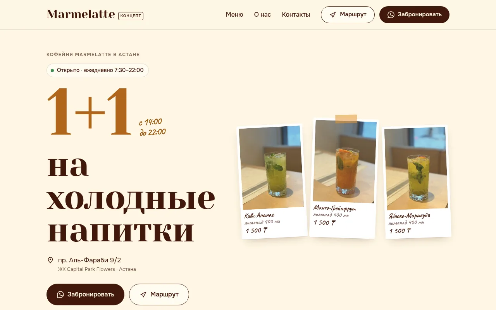

# Marmelatte — концепт сайта кофейни

**Бизнес:** Кофейня Marmelatte, Астана. Демонстрационный концепт для портфолио.

## Задача
Мобильный одностраничник с меню кофейни. В бриф входило правило использовать только подтверждённые данные.

## Что сделано
- Меню с вкладками по категориям: завтраки, салаты, горячее, паста, супы, десерты, напитки
- Блок «Акция 1+1» и комбо
- Блоки «Делаем», «С детьми», «Кофе», отзывы и контакты

## Стек
Чистые HTML, CSS и JavaScript без фреймворков, шрифты Yeseva One, Onest и Caveat. Деплой — Cloudflare Workers (статические файлы, Wrangler).

## Демо
https://marmelatte-concept.a-a-studio.workers.dev

## Примечание
Бриф проекта лежит в brief.md.

---
Сделано с помощью AI-инструментов (Cursor, AI-агенты) под моим руководством.
